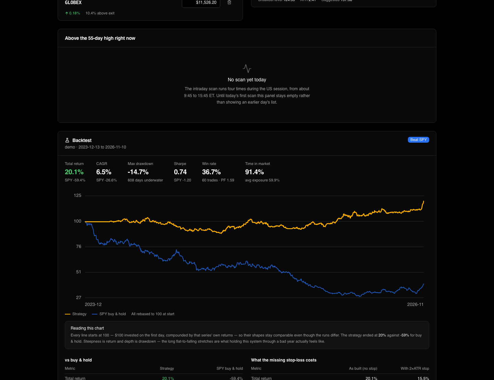
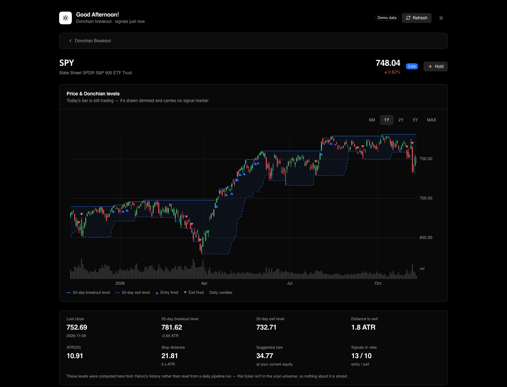
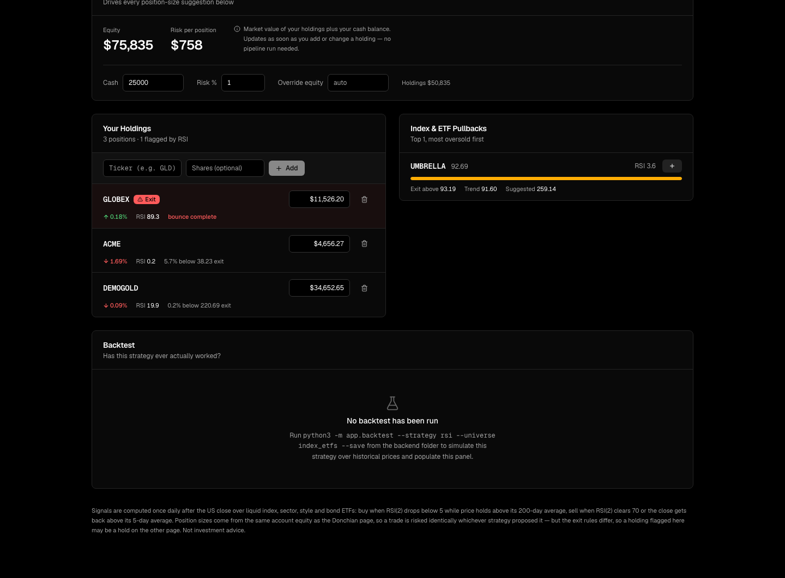
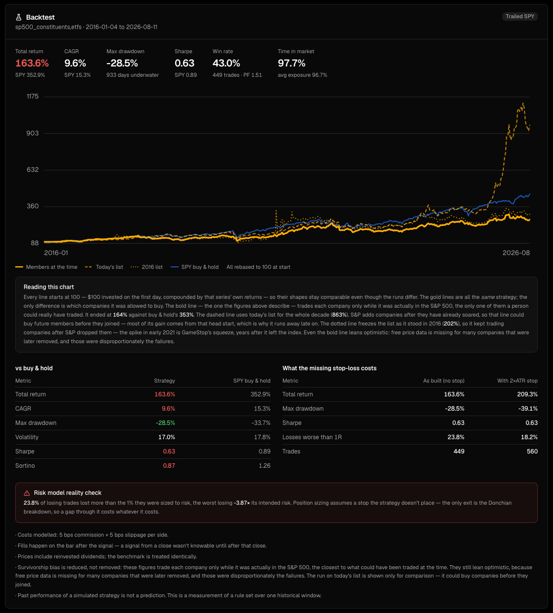
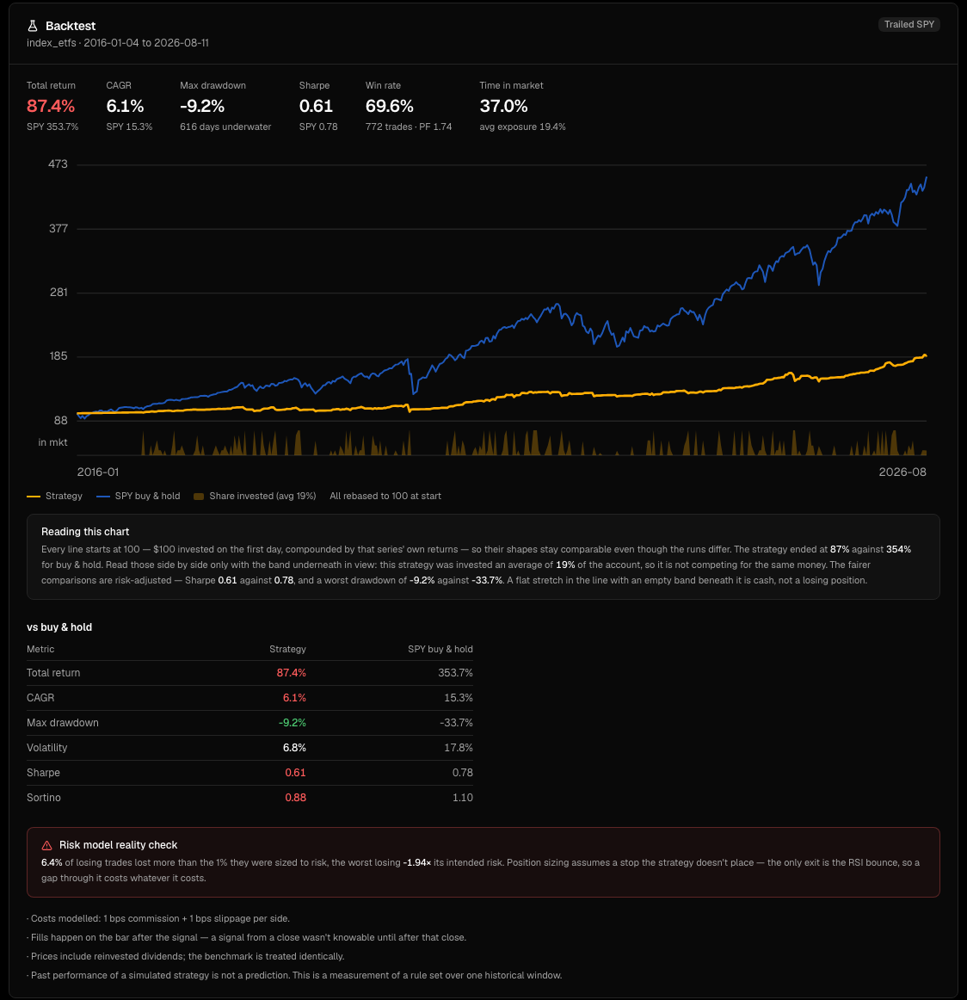

# Stock Signal Dashboard

A trading-signal dashboard and backtesting lab built around two mechanical
strategies: a **Donchian channel breakout** across the S&P 500 and an
**RSI(2) pullback** on index ETFs. It runs every evening on a schedule,
tells you when something you hold has hit its exit, ranks the strongest new
breakouts, and sizes each one to your account.

It also measures itself. A backtester built on the same signal code
replays both strategies over 2016–2026, and a research log records more
than ten attempts to improve them. Most of those attempts failed, and the
log says so.




## Highlights

- **Full stack:** a Python pipeline with FastAPI and SQLite, plus a React 19,
  TypeScript and Tailwind v4 frontend. It has a demo mode that needs no
  network or API keys.
- **Point-in-time backtesting:** each company is traded only while it was
  actually in the S&P 500. That removes most of the survivorship bias that
  inflates naive backtests (863% becomes 164%).
- **Look-ahead is prevented by construction:** signals read the decision bar
  and fills happen on the next bar. Truncation-invariance tests fail if any
  future value leaks into the past.
- **Honest reporting:** results come as ranges with the reason for the
  range. The dashboard shows where the strategy *loses* to buy-and-hold, and
  where its own risk model is falsified.
- **Production hardening for a laptop:** launchd scheduling, resistance to
  sleep and wake, a guard against unfinished bars, retries, and a log line
  per run that says plainly whether the run was healthy.
- **325 tests**, none of which need network access.

## What it does

Every weekday after the US close, a pipeline pulls daily prices for about
550 tickers from Yahoo Finance and computes, per ticker:

| Level | Meaning |
|---|---|
| 55-day Donchian high | close above it → **entry signal** (breakout) |
| 20-day Donchian low | close below it → **exit signal** |
| ATR(20) | volatility, used for stop distance (2×ATR) and position sizing |

The dashboard then shows:

- **Exit signals on your holdings**, surfaced first and in red, because
  they're what you actually need to act on.
- **The top 10 entry candidates**, ranked by how many ATRs past the breakout
  level each one closed, excluding anything you already own.
- **Position sizes** chosen so that a stop-out costs a fixed fraction of
  equity. They update the moment you change your cash or holdings.
- **An intraday watchlist** that scans four times during the session for
  tickers trading above their 55-day high. It's a heads-up only, and the UI
  says so: the strategy decides on closes.
- **A ticker page** for any symbol, with candles, the Donchian channel
  shaded, and a marker on each bar where an entry or exit actually fired.



A second page runs **RSI(2) pullback**, a short-horizon mean-reversion
strategy. It's the opposite of a breakout: it buys sharp dips in liquid
index, sector and bond ETFs that are still above their 200-day average.



## Does it work?

Measured over 2016–2026, with dividends reinvested and trading costs
modelled:

| | Donchian (S&P members at the time) | RSI(2) (index ETFs) | SPY buy & hold |
|---|---|---|---|
| Total return | 164% | 87% | 353% |
| CAGR | 9.6% | 6.1% | 15.3% |
| Max drawdown | −28.5% | **−9.2%** | −33.7% |
| Sharpe | 0.63 | 0.61 | 0.89 |
| Time invested | ~97% | ~19% | 100% |

**Neither strategy beats buying and holding SPY over this decade.** The
backtester exists to find that out, not to hide it.



What the measurements found along the way:

- **Survivorship bias is most of the naive result.** Running the identical
  strategy on *today's* S&P list gives 863%. Running it on the companies
  that were actually members at each date gives 164%. Today's list lets
  the backtest buy future winners before they joined the index.
- **The strategy's own risk model is falsified.** It sizes positions so a
  stop-out costs 1% of equity, but its only exit is the channel breakdown.
  As a result, 23.8% of losing trades lost more than 1%, and the worst lost
  3.9× that.
- **RSI(2)'s edge is real, and costs decide it.** Frictionless, it returns
  185% on single stocks. At retail costs on single stocks, it returns about
  zero. On penny-spread index ETFs, it becomes a low-drawdown diversifier.
  That's why its universe is baskets, not companies.



## Research log

[`research/README.md`](research/README.md) records each experiment the same
way: the hypothesis, the exact setup, the numbers, and what it means.
Several experiments were pre-registered, meaning the success criteria were
committed before any result was computed. A sample:

| Experiment | Result |
|---|---|
| Short after two sell signals | −45% combined; the short leg alone −86% |
| Sell the weakest holding to fund new breakouts | best variant 60% vs 164% |
| Skip entries when volatility is abnormally high | 98% vs 164%; it blocks the *best* trades |
| Trade S&P index additions on announcement | lowers return and Sharpe in every variant |
| Liquidity-sweep reversal (ICT-style) on NQ futures, 1-minute data | flat (+0.035R/trade), after fixing a look-ahead leak that had made it look like +25R |
| Three short strategies on the Donchian levels | all lose alone; none improves the long book |

The overall conclusion: in 2016–2026, a stock breaking a low or failing at
a high bounced about as often as it followed through. That's why seven
different short rules all lost money.

## Design notes

**The backtester reuses the live signal code.** A backtest with its own
copy of the strategy stops describing the real system the moment either
side changes. A dedicated engine for research variants is checked to
reproduce the main engine to the cent with its additions switched off.

**Position sizing is resolved at read time, not stored.** Stop distance is
a market fact the pipeline computes. Equity isn't: it changes when you
deposit or trade, with no price moving. Keeping them apart means editing
your cash balance re-sizes every suggestion immediately.

**Unfinished bars are dropped, not trusted.** The pipeline removes today's
in-progress bar before computing anything. A run during market hours once
stored a price that the close later moved, and signals are defined on
closes.

**A holding's amount is in the ticker's own quote unit.** Gold bullion is
tracked as `GC=F` (quoted per troy ounce) with ounces in the amount field.
Converting it to gold-ETF shares would drift, because an ETF share
represents a shrinking fraction of an ounce.

**Write access has three postures, chosen by environment:** open
(localhost), API-key required (private deploy), and read-only (public
demo). The API prints which one is active at startup, because a
misconfigured instance otherwise looks identical to a correct one.

**Timestamps are stored naive-UTC and served with an explicit `+00:00`.**
JavaScript's `Date()` reads a bare timestamp as local time, which would
silently skew the frontend's stale-data check.

## Layout

```
backend/
  app/            FastAPI app, daily pipeline, signals, intraday watch
  app/backtest/   backtest engine, universes, metrics, reports
  research/       one-off research harnesses (shorts, sweep reversal, …)
  tests/          pytest suite (no network)
  scripts/        launchd wrappers for the nightly run and intraday scans
frontend/         React + TypeScript + Tailwind v4 dashboard
research/         the research log
docs/screenshots/
```

[`backend/README.md`](backend/README.md) is the detailed lab notebook:
setup, every endpoint, the full backtest methodology, and the reasoning
behind the trickier parts.

## Quickstart

You need Python 3.12+ and Node 20+. Pick one of three ways to run it.

### 1. The real dashboard (recommended)

The repo ships a snapshot of the live dashboard's data: real signals for
about 550 tickers, the watchlist, and every saved backtest. It has no
holdings and no account details in it. To start from it:

```bash
cd backend && pip3 install -r requirements.txt
python3 -m app.bootstrap          # copies the snapshot to data/real.db (never overwrites)
python3 -m app.pipeline           # optional: refresh signals to today (a few minutes; needs internet)
python3 -m uvicorn app.main:app --reload --port 8000
```

```bash
cd frontend && npm install && npm run dev
```

Open http://localhost:5173. You'll see the same pages as in the
screenshots: entry candidates, ticker charts, the RSI(2) page and both
real backtests.

- **Holdings:** yours start empty. Add your own and exit signals will
  appear for them.
- **Position sizes:** these are computed for a labelled $100,000
  placeholder account until you enter your own cash in the Account panel.
- **Stale signals:** if you skip the pipeline step, the header shows how
  old the signals are.

### 2. Demo mode (no network)

This seeds a database with fictitious tickers, so you can click around
offline:

```bash
cd backend && pip3 install -r requirements.txt
DEMO_MODE=true python3 -m app.seed_demo
DEMO_MODE=true python3 -m uvicorn app.main:app --reload --port 8000
```

Then start the frontend as above.

### 3. Reproduce the backtests yourself

The snapshot's backtests can be regenerated from scratch with
`python3 -m app.backtest`. That downloads about 10 years of daily prices,
so the first run is slow. The exact commands for each run are in
[backend/README.md](backend/README.md#backtesting).

### Refreshing the snapshot (maintainer)

`python3 -m app.public_snapshot` rebuilds `backend/data/snapshot/dashboard.db`
from your own `real.db`:

- It deletes all holdings and account settings.
- It blanks the stored share counts, which were sized to your equity.
- It compacts the file so deleted rows don't linger in it.
- It refuses to run if the database contains a table it doesn't recognise.

Rebuild and commit after saving new backtests. That's occasional, not
nightly.

## Tests

```bash
cd backend && pip3 install -r requirements.txt -r requirements-dev.txt && python3 -m pytest tests/ -q
```

The tests cover:

- the signal math, including that the Donchian windows are shifted so
  today's high can't be part of the level it has to break
- the backtest engine: look-ahead detection, capital rationing, off-by-one
  errors
- historical index membership, including correcting the source data's own
  errors
- the intraday watch and the unfinished-bar guard
- the research harnesses
- the API, including auth postures and validation

## Data sources

- **Prices:** Yahoo Finance, via `yfinance`.
- **Historical S&P 500 membership:** a point-in-time workbook compiled
  from the public [fja05680/sp500](https://github.com/fja05680/sp500)
  dataset and Wikipedia's *List of S&P 500 companies* change log,
  cross-checked against S&P Dow Jones Indices announcements. Its
  methodology and known limitations are documented inside the workbook
  (`backend/data/universes/sources/`).

## Disclaimer

This is a personal project for studying mechanical signal systems. It is
not investment advice, and the suggested position sizes are arithmetic,
not recommendations.

## License

[MIT](LICENSE)
